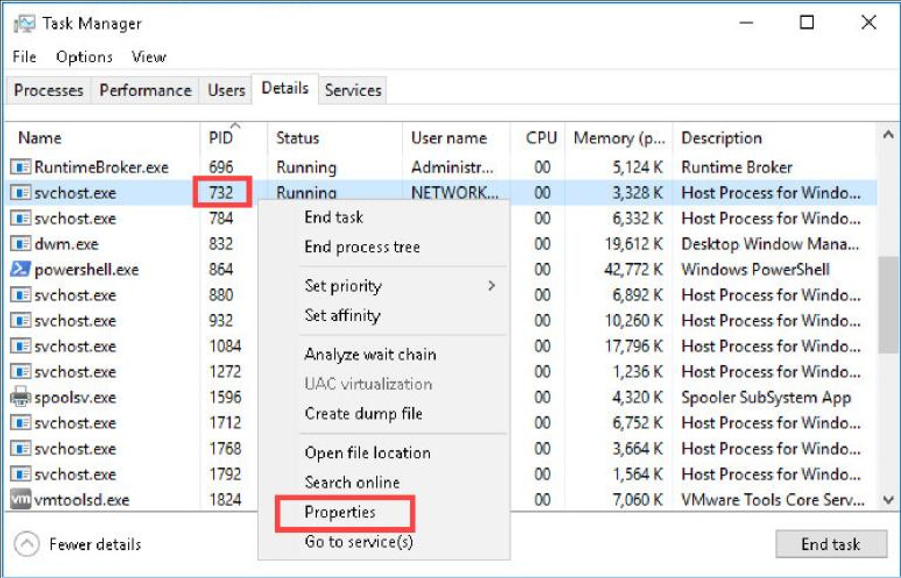
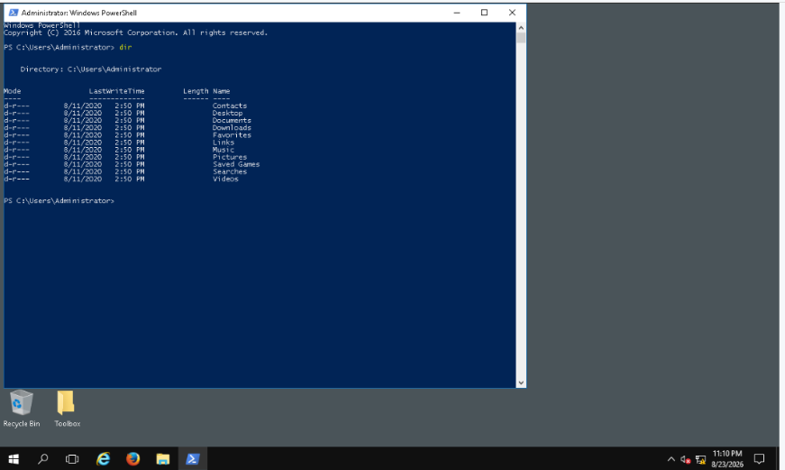
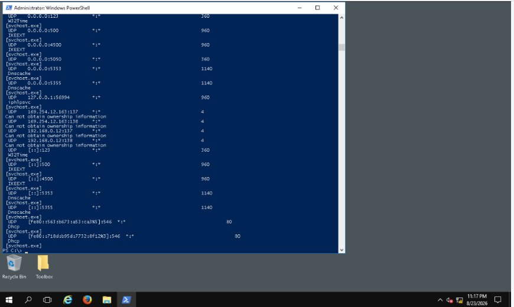
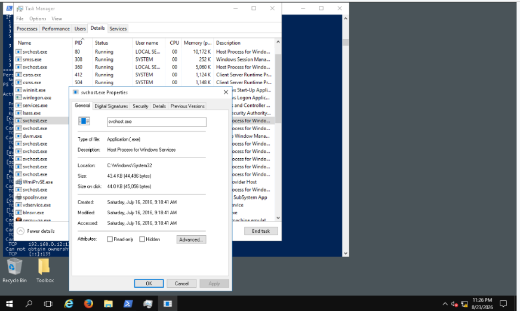
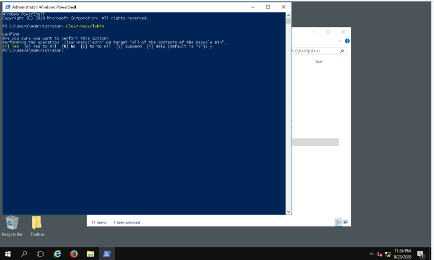

# Windows-PowerShell-Administration
Windows administration, network diagnostics, and troubleshooting labs
# Windows PowerShell Administration and Network Diagnostics

## Project Overview
This project documents a Cisco Networking Academy academic lab focused on using Windows PowerShell for basic system administration and network diagnostics.

## Tools and Environment
- Windows PowerShell
- Windows Command Prompt
- Windows Task Manager
- NETLAB+ lab environment
 

## Skills Explored
- File and directory navigation
- PowerShell aliases and commands
- Network connectivity testing
- IP configuration and routing tables
- Network connections and process identifiers (PIDs)
- Windows administrative utilities

## Commands Covered
| Command | Purpose |
|---|---|
| `dir` | List files and directories |
| `Get-ChildItem` | View files and directories |
| `Get-Alias dir` | Identify the command associated with an alias |
| `ping` | Test network connectivity |
| `ipconfig` | Display IP configuration |
| `netstat -r` | View the routing table |
| `netstat -abno` | Examine connections, executable names, and PIDs |
| `Clear-RecycleBin` | Clear Recycle Bin contents |

## What I Learned
This lab introduced PowerShell as a useful tool for Windows administration and IT troubleshooting. Understanding IP configuration, network connections, and process identifiers provides a foundation for help desk support and security investigations.

## Evidence
Screenshots and selected verified command results will be added after review.

## Lab Attribution
Based on Cisco Networking Academy Lab 3.3.11 — Using Windows PowerShell. Documentation is written as an original learning summary.
## Lab Screenshots

The following screenshots document selected activities from my Windows PowerShell administration lab.

### 1. Windows Task Manager

### 2. PowerShell Directory Navigation

### 3. PowerShell Command Execution

### 4. Windows Process Inspection

### 5. PowerShell Administration

## Technical Skills Demonstrated

### 1. Windows Network Troubleshooting
Used Windows networking utilities during the academic lab to examine system network configuration and connectivity.

- `ipconfig` — Displays network adapter configuration and IP addresses.
- `ping` — Tests connectivity to another network device.
- `netstat -r` — Displays the system's routing table.

### 2. PowerShell Navigation
Explored PowerShell commands used to navigate and inspect the Windows file system.

- `dir` — Lists files and folders.
- `Get-ChildItem` — Retrieves directory contents.
- `Get-Alias dir` — Identifies the PowerShell command represented by the `dir` alias.

### 3. Process and Connection Investigation
Examined how Windows identifies running processes and associates them with network activity.

- `netstat -abno` — Displays network connections, executable information, and process identifiers when sufficient permissions are available.
- Windows Task Manager — Provides process information that can be correlated with PIDs.

### 4. Application to IT Support
These techniques provide a foundation for diagnosing connectivity problems, examining Windows processes, and gathering information before escalating a support ticket.

## Project Reflection
This lab helped me become more familiar with Windows administration, PowerShell commands, process inspection, and basic network diagnostics. These skills provide a foundation for entry-level help desk, desktop support, and cybersecurity roles.
